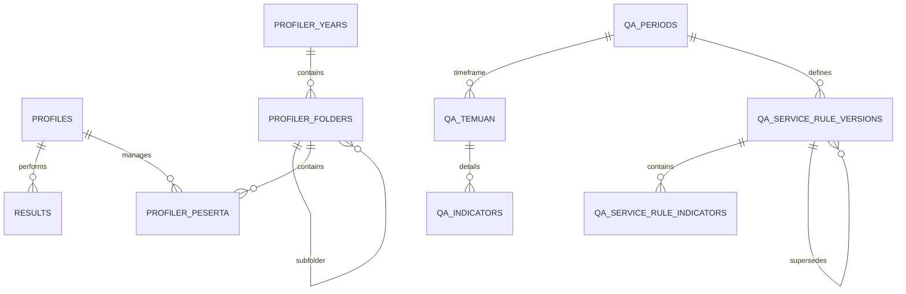

# Database Schema & Security

Dokumen ini menjelaskan struktur tabel PostgreSQL di Supabase dan kebijakan Row Level Security (RLS) yang diterapkan, serta model hak akses eksplisit (Explicit Data API Grants) untuk keamanan maksimal.

---

## 🌟 Pengantar untuk Pengguna Umum (Human-Readable Overview)

### Apa itu Struktur Database dan Keamanan Ini?

Database Supabase bertindak sebagai brankas utama tempat seluruh data aplikasi Trainers SuperApp disimpan—mulai dari informasi akun pengguna, hasil simulasi pelatihan, hingga temuan audit kualitas.

Sistem keamanan database kami dirancang dengan prinsip **"Tolak Akses Sejak Awal" (Deny-by-Default)**. Artinya, secara bawaan, tidak ada satu pun orang atau program luar yang diizinkan mengintip atau mengubah isi tabel apa pun, kecuali mereka memiliki kunci atau izin khusus yang secara eksplisit diberikan oleh sistem.

### Manfaat Langsung bagi Pengguna:

1. **Privasi Data Terjamin:** Data pribadi, nilai simulasi, dan rekaman suara Anda sepenuhnya terisolasi. Pengguna lain tidak akan bisa melihat data Anda tanpa otorisasi yang sah.
2. **Perlindungan dari Pihak Luar:** Pihak yang tidak masuk log (_unauthenticated/anon_) tidak memiliki celah untuk menebak-nebak daftar email pengguna atau mengakses fitur apa pun di latar belakang.
3. **Keteraturan Kerja:** Setiap peran (Agent, Leader, dan Trainer) memiliki jalur atau pintu khusus. Hal ini mencegah kekeliruan, seperti Agent tanpa sengaja mengubah pengaturan harga atau menghapus rekaman orang lain.

---

## KETIK — penulisan history hanya melalui backend

Migration `20261015120000_ketik_history_backend_insert_only.sql` mencabut policy
`ketik_history_insert_own`. Dengan RLS aktif dan tanpa policy INSERT, pengguna
`authenticated` tidak bisa menyisipkan history langsung, termasuk skor dan status
review arbitrer. Policy SELECT owner-only, grant tabel, dan trigger atribusi subjek
tidak berubah. Penyimpanan sesi sah tetap melalui API dengan pemeriksaan capability
serta resolver subjek, kemudian RPC `finish_ketik_session()` memakai service-role backend.

Rollback pasangannya mengembalikan policy lama **dan membuka kembali risiko**;
jangan menerapkannya tanpa persetujuan rollback keamanan. SQL migration/rollback
sudah diuji pada Supabase lokal disposable, bukan database remote. Perubahan ini
berdiri sendiri; otoritas transkrip sesi baru disediakan migration sesi server di bawah.

## KETIK — pagination riwayat

Migration `20261015145210_ketik_history_pagination.sql` menambah indeks
`ketik_history_owner_date_id_idx(user_id,date DESC,id DESC)` dan RPC baca
`ketik_history_page(uuid,integer,text,text,timestamptz,uuid)`. RPC SECURITY INVOKER,
search_path kosong, EXECUTE hanya service_role (PUBLIC/anon/authenticated dicabut).
Owner selalu ditentukan backend; SQL parameterized, pencarian literal substring
skenario/konsumen/peserta, filter status, count/average atas seluruh hasil filter,
dan keyset `(date,id)` mempertahankan presisi microseconds. Proyeksi daftar
mengecualikan messages; transkrip hanya di detail owner. Tidak ada perubahan RLS,
policy/grant tabel, data, atau skor lama. Rollback pasangannya menghapus RPC/index
saja; backend yang mengharapkan RPC akan mengembalikan error eksplisit sampai
migration di-reapply. Summary memakai count exact (bukan jumlah row maksimal
PostgREST), rentang bulan WIB, serta query bounded lima reviewed/tiga follow-up.

## KETIK — provenance penugasan konfigurasi

Migration `20261015130000_ketik_configuration_assignments.sql` menambah
`ketik_configuration_assignments` (recipient PK, assigner, snapshot konfigurasi
training sumber, versi settings sumber, versi UUID assignment, waktu penugasan).
Snapshot tidak memuat identitas atau template trainer; settings aktif tetap di
`user_settings.settings.ketik` milik penerima dan boleh diedit secara pribadi.

RPC `assign_ketik_configuration` hanya diberi EXECUTE kepada `service_role`.
Transaksi mengunci profil penerima, memvalidasi role/status dan ownership, memeriksa
versi source/recipient/assignment, lalu menyalin enam field training dan menerbitkan
provenance secara atomik. Identitas/template pribadi, settings modul lain, dan
perubahan yang lebih baru tidak ditimpa. RLS authenticated hanya SELECT untuk
recipient/assigner; INSERT/UPDATE/DELETE dan RPC langsung ditolak.

Rollback menghapus fungsi/tabel provenance, tetapi **mempertahankan settings
pribadi penerima**. Hentikan assignment writes dahulu. Apply/rollback/reapply hanya
diuji di database lokal disposable; tidak ada backfill atau migration remote.
Kewajiban assignment ditegakkan pada endpoint mulai sesi server berikut.

## KETIK — sesi dan transkrip server

Migration `20261015140000_ketik_server_sessions.sql` menambah fondasi sesi;
migration `20261020160000_ketik_durable_agent_messages.sql` memisahkan append
agen dari pemicu balasan:

- `ketik_sessions`: snapshot immutable konfigurasi/skenario/subjek/versi assignment,
  pemilik, waktu server, versi, `agent_version`, dan transkrip aktif. Sesi belum
  selesai tidak masuk History/Monitoring/SIDAK. `agent_version` hanya naik saat
  pesan agen dipersist agar publish konsumen tidak membuat append browser stale.
- `ketik_session_turns`: ledger request UUID dan payload agen untuk idempotensi.
  Append baru langsung terminal `completed`; row lease lama tetap dibaca untuk
  kompatibilitas endpoint `/turns`. Maksimal efektif 100 perubahan transkrip.
- `ketik_session_responses`: request UUID pemicu balasan, versi konteks agen,
  retry count 0/1, status, dan lease/fencing. Hanya satu response aktif per sesi.
  Tabel ini bukan sumber transkrip penilaian kedua.
- `ketik_history.transcript_provenance`: `legacy` untuk row lama dan `server_v1`
  untuk finalisasi sesi baru. Tidak ada backfill atau regrade.

RPC start/legacy-turn/finish serta `append_ketik_session_message`,
`claim_ketik_session_response`, `settle_ketik_session_response`, dan
`fail_ketik_session_response` adalah SECURITY INVOKER dan EXECUTE
service-role-only. Authenticated hanya SELECT owner pada kolom status yang aman
di tiga tabel operasional; token `lease` response tidak diberi SELECT. Start
memeriksa status akun, versi settings dan assignment wajib agen/leader. Append
memvalidasi owner/agent-version/state dan menyimpan pesan agen sekali; setelah
migration closing di bawah, expiry/consumer_closed tidak lagi menolak append. AI
berlangsung di luar transaksi; settle membandingkan context `agent_version`:
perubahan pertama memperbarui snapshot dan memberi satu retry, perubahan kedua
menandai request `superseded` tanpa memublikasikan hasil stale. Respons lease lama
tidak bisa dipublikasikan. Setiap provider call tetap dicatat, tetapi tidak ada
jaminan exactly-once biaya provider ketika crash/reclaim.

Finalisasi atomik menulis history ber-ID sama tanpa skor, lalu mengosongkan
`ketik_sessions.messages`; replay finish membaca history yang sama. Sesi kosong
discarded. Menghapus history menghapus metadata sesi/turn lewat FK; menghapus
metadata operasional tidak menghapus history. Rollback menolak adanya sesi aktif,
mempertahankan history/skor, tetapi menghapus metadata sesi dan label provenance.
Hentikan writes dahulu; pengujian apply/rollback/reapply hanya pada DB lokal
(disposable, ledger CLI tidak diperbarui), bukan izin apply remote.

## ER Diagram (Overview)

## Tabel Utama

### `qa_temuan` — tanggal bisnis (opsional)

| Kolom             | Tipe        | Arti                                                                                          |
| ----------------- | ----------- | --------------------------------------------------------------------------------------------- |
| `tanggal_layanan` | `date NULL` | Kapan layanan/interaksi yang ditinjau benar-benar terjadi. Dasar mode **Agent** pada heatmap. |
| `tanggal_sampel`  | `date NULL` | Kapan QA memeriksa sampel dan menetapkan temuan. Dasar mode **QA** pada heatmap.              |

Aturan yang berlaku:

- **NULL berarti "belum diisi"**, bukan "tidak berlaku". Kolom kosong tidak pernah diisi default.
- **Tidak ada backfill.** Baris lama tetap NULL. `created_at`/`updated_at` **tidak** dipakai sebagai pengganti — keduanya mencatat kapan baris masuk sistem, bukan kapan interaksi terjadi.
- **Satuan heatmap**: `no_tiket` (nullable) menjadi dasar satuan **Tiket** — heatmap menghitung `distinct no_tiket` per hari; baris tanpa nomor tiket tetap dihitung per baris. Tanpa kolom itu, satuan Tiket tidak mungkin. Tidak ada constraint baru untuk mode ini.
- **Tanpa constraint silang.** Tidak ada CHECK yang mengikat tanggal ke periode audit atau mengurutkan sampel setelah layanan; keduanya perlu persetujuan terpisah.
- **Tidak ada perubahan** pada index, constraint duplikat, policy RLS, atau grant. Policy `read_all`/`write_trainer` yang ada sudah berlaku karena tidak membedakan kolom.
- **Format**: API selalu mengirim `YYYY-MM-DD` dan memvalidasinya sebagai tanggal kalender nyata (`2026-02-30` ditolak, leap day mengikuti tahun). Kontrak bersama: `tanggalSchema` di `packages/types/src/sidak.ts`.
- **Penyimpanan per baris.** Satu tiket dapat punya beberapa baris (satu per parameter); tanggal ikut per baris, tidak ada deduplikasi per tiket.

Migration: `20261001120000_add_temuan_business_dates.sql` (nullable `DATE`, idempotent). **Diterapkan ke target `ruosnjmtywcrghjgqugz` pada 2026-10-02** dan tercatat sebagai history `applied`; kolom `date NULL` + komentar terverifikasi, RLS/policy dan grant tidak berubah.

**Catatan Migration Baseline:** Schema aplikasi dikelola di `supabase/migrations/`. Migration Phase 4 di bawah adalah artifact repository yang additive dan transactional; keberadaannya di tree tidak berarti sudah diterapkan ke database remote.

**Core Migrations (000–017):**

- `000_profiles_core.sql` — Profiles & auth tables
- `001_sidak_core.sql` — SIDAK core + Profiler tables (12 tables, all RLS-enabled)
- `002_ketik_pdkt_core.sql` — KETIK, PDKT, AI usage tables
- `003_telefun_core.sql` — Telefun tables
- `004_admin_core.sql` — Admin management tables
- `005_carbon_copy_parity.sql` — KETIK/PDKT carbon copy parity features
- `006_create_user_settings.sql` — User settings table
- `007_report_archives.sql` — Report archives for persistence
- `008_profile_admin_policies.sql` — Admin/trainer SELECT+UPDATE on profiles
- `009_storage_rls_policies.sql` — Storage bucket RLS policies
- `010_activity_logs_index.sql` — Index `activity_logs.created_at`
- `011_materialized_view_dashboard.sql` — Materialized view `mv_qa_period_summary`
- `012_ai_usage_status_error.sql` — AI usage status/error columns
- `013_refresh_mv_function.sql` — RPC `refresh_mv_qa_period_summary()`
- `014_storage_buckets.sql` — Storage bucket policies
- `015_tighten_sidak_rls.sql` — SIDAK RLS tightening
- `016_harden_profiles_rls.sql` — Profiles RLS hardening
- `017_harden_mv_qa_period_summary.sql` — MV hardening (revokes from non-service_role)

**Timestamp Migrations (20260520–20260801):**

| Migration                                                                 | Purpose                                                                                                                      |
| ------------------------------------------------------------------------- | ---------------------------------------------------------------------------------------------------------------------------- |
| `20260520054101_add_is_deleted_to_profiles.sql`                           | Add `is_deleted` column to profiles                                                                                          |
| `20260522093000_profiler_unique_constraints.sql`                          | Profiler unique constraints                                                                                                  |
| `20260523000000_telefun_parity_extensions.sql`                            | Telefun parity extensions                                                                                                    |
| `20260525000100_sidak_dashboard_summary_vite_schema_refresh.sql`          | Target-schema-compatible `refresh_qa_dashboard_summary_for_period`                                                           |
| `20260525000200_restore_mv_qa_period_summary_contract.sql`                | Idempotent MV + refresh function contract repair                                                                             |
| `20260525000300_telefun_history_add_consumer_contact_columns.sql`         | Add consumer_phone and consumer_city to telefun_history                                                                      |
| `20260525000400_telefun_history_add_feedback.sql`                         | Add feedback column to telefun_history                                                                                       |
| `20260525000500_telefun_history_add_metadata_columns.sql`                 | Add metadata columns to telefun_history                                                                                      |
| `20260526090000_reharden_mv_qa_period_summary_after_contract_restore.sql` | Terminal re-hardening: revoke all non-service_role access                                                                    |
| `20260527000000_add_unique_index_qa_temuan_duplicate_input.sql`           | Unique index on qa_temuan for duplicate prevention                                                                           |
| `20260527000001_add_simulation_duration_to_ketik_history.sql`             | Add `simulation_duration` to ketik_history                                                                                   |
| `20260527000002_add_unique_index_ketik_review_jobs_session_id.sql`        | Unique index on ketik_review_jobs                                                                                            |
| `20260602000000_fix_bulk_reorder_profiler_peserta_auth.sql`               | Fix profiler reorder authorization                                                                                           |
| `20260603090000_pdkt_shared_mailbox_policy.sql`                           | PDKT shared mailbox RLS + soft-delete RPC                                                                                    |
| `20260603100000_pdkt_fix_soft_delete_rpc.sql`                             | Fix soft_delete_pdkt_mailbox_item RPC                                                                                        |
| `20260604100000_restore_profiler_foto_bucket.sql`                         | Restore profiler-foto storage bucket                                                                                         |
| `20260605100000_atomic_monitoring_history_delete.sql`                     | Atomic monitoring history delete RPC                                                                                         |
| `20260611100000_fix_telefun_coaching_summary_rpc_contract.sql`            | Fix telefun coaching summary RPC                                                                                             |
| `20260611200000_telefun_scoring_lifecycle.sql`                            | Telefun scoring lifecycle contract                                                                                           |
| `20260611201000_telefun_scoring_retry_queue.sql`                          | Telefun scoring retry queue                                                                                                  |
| `20260612000000_fix_profiles_rls_recursion.sql`                           | Fix profiles RLS recursion                                                                                                   |
| `20260614090000_sidak_dashboard_forecast_snapshots.sql`                   | SIDAK dashboard forecast snapshots table                                                                                     |
| `20260618100000_add_get_profiler_folder_counts_rpc.sql`                   | RPC `get_profiler_folder_counts(uuid[])`                                                                                     |
| `20260618101000_add_access_groups_count_view.sql`                         | View `v_access_groups_with_item_counts`                                                                                      |
| `20260618102000_add_get_leader_scope_snapshot_rpc.sql`                    | RPC `get_leader_scope_snapshot(uuid, text)`                                                                                  |
| `20260618110000_add_mimo_model_pricing.sql`                               | Add MiMo model pricing                                                                                                       |
| `20260618200000_fix_billing_singleton_upsert.sql`                         | Fix billing singleton upsert                                                                                                 |
| `20260618210000_ai_usage_modality_tokens.sql`                             | AI usage modality token columns                                                                                              |
| `20260618220000_ai_usage_reconciliation_view.sql`                         | AI usage reconciliation view                                                                                                 |
| `20260619090000_telefun_live_per_minute_billing.sql`                      | Telefun live per-minute billing columns                                                                                      |
| `20260622150000_repair_telefun_scoring_lifecycle_contract.sql`            | Repair telefun scoring lifecycle contract                                                                                    |
| `20260630003553_add_current_sidak_profiler_lookup_indexes.sql`            | SIDAK profiler lookup indexes                                                                                                |
| `20260801120000_telefun_openai_webrtc_phase4_durable_lifecycle.sql`       | Additive Telefun WebRTC attempt/transcript/usage/finalization, recording readiness, scoring lock, and service-role RPCs      |
| `20260801142542_telefun_openai_webrtc_phase5_production_hardening.sql`    | Distributed WebRTC lease/quota, rate-limit windows, orphan cleanup, hashed-user metrics, and precise network/orphan outcomes |
| `20260811044655_fix_telefun_realtime_lease_renewal.sql`                   | Repair ambiguous lease-expiry reference and add bounded renewal rejection reasons; hosted production canonical verified      |
| `20260904150000_telefun_scoring_claim_fencing.sql`                        | Embedded API scoring worker lease 300s, claim-token fencing, and additive RPC compatibility signatures                       |
| `20260910000000_simulation_subject_attribution.sql`                       | Persist immutable simulation-subject snapshots across KETIK/PDKT/Telefun and extend the authenticated PDKT mailbox batch RPC |
| `20260910120000_ketik_global_quick_templates.sql`                         | Singleton template cepat KETIK standar, backfill dari admin pertama, dan service-role-only persistence                       |

### 1. `public.profiles`

Menyimpan data profil user yang terintegrasi dengan `auth.users`.

- `id` (UUID, Primary Key): ID user dari Supabase Auth.
- `email` (Text, Unique): Email user.
- `full_name` (Text): Nama lengkap user.
- `role` (Text): Role user (`admin`, `trainer`, `leader`, `agent`).
- `status` (Text): Status akun (`pending`, `approved`, `rejected`).
- `created_at` (Timestamptz): Timestamp pendaftaran akun.
- `is_deleted` (Boolean): Flag untuk soft delete akun.

### 2. `public.results`

Menyimpan hasil simulasi legacy/kompatibilitas dari modul Ketik dan Telefun.

- `id` (UUID, Primary Key): ID unik hasil simulasi.
- `user_id` (UUID): Referensi ke `auth.users(id)`.
- `module` (Text): Nama modul.
- `score` (NUMERIC): Skor hasil simulasi.
- `details` (JSONB): Detail hasil, metadata.
- `created_at`, `updated_at` (Timestamptz): Timestamp.

### 3. Modul Simulasi

- **`ketik_history`**: Riwayat sesi KETIK per user, termasuk skenario, identitas konsumen, messages, dan `simulation_duration` (durasi simulasi dalam menit, nullable untuk backward compatibility).
- **`ketik_session_reviews`**: Hasil review AI per sesi KETIK. Berisi skor, rubrik, dan feedback dalam format JSONB.
- **`pdkt_history`**: Riwayat sesi PDKT per user, email thread, config, dan hasil evaluasi async. Migration `20261016153729_pdkt_history_integrity_privacy` mencabut policy INSERT owner serta privilege INSERT/UPDATE client. SELECT authenticated hanya untuk kolom scalar/evaluasi dengan RLS owner; `config`/`emails` tidak dapat dibaca atau difilter langsung. Backend memverifikasi ID lewat JWT user, membaca snapshot privat dalam batch 100 ID (menghindari batas URL gateway), lalu mengirim proyeksi replay tanpa kunci jawaban/persona/arah penerima. RPC balasan SECURITY DEFINER dan evaluator service-role tetap bekerja. Tidak ada backfill atau penghapusan row; rollback mengembalikan akses lama yang tidak aman. Keberadaan migration tidak membuktikan penerapan remote.
- **`pdkt_mailbox_items`**: Kotak masuk simulasi PDKT yang persisten. Menyimpan inbound email, status (`open`, `replied`, `deleted`), thread, serta snapshot scenario/config. Beberapa snapshot dapat memuat attachment inline yang sama; kontrak list API karena itu hanya memproyeksikan kolom scalar, sedangkan email dibaca secara lazy melalui detail per-id. Sejak migration `20261013120000_pdkt_mailbox_hide_snapshot_columns`, role `authenticated` hanya punya `SELECT` per kolom scalar (RLS `pdkt_mailbox_select_all` tetap): empat kolom JSON (`scenario_snapshot`, `config_snapshot`, `inbound_email`, `emails_thread`) tidak bisa dibaca atau difilter langsung oleh client, karena memuat kunci jawaban, karakter konsumen, dan penerima email. Kolom baru tidak otomatis terbaca client sampai di-grant. API detail membaca email setelah visibilitas lolos lewat JWT user, dan RPC SECURITY DEFINER tidak terdampak.
- **`telefun_history`**: Riwayat sesi TELEFUN per user, termasuk skenario, durasi, URL/path rekaman, skor, feedback, dan Phase 4 recording/scoring readiness state.
- **`telefun_replay_annotations`**: Anotasi AI dan manual untuk fitur Replay Telefun.
- **`user_settings`**: Settings modul yang disimpan per user untuk KETIK, PDKT, dan TELEFUN. Untuk KETIK, `quickTemplates` pada namespace tersimpan menjadi daftar template pribadi pemilik; API menggabungkannya dengan template standar global saat membaca settings.
- **`ketik_global_settings`**: Singleton (`key = 'default'`) yang menyimpan `quick_templates` standar KETIK untuk seluruh user. Tabel memakai RLS deny-by-default, mencabut grant dari `anon`/`authenticated`, dan hanya memberi akses ke `service_role`; endpoint API membatasi mutasi ke role `admin`. Migration melakukan backfill satu kali dari template KETIK milik admin pertama yang memiliki row settings, tanpa menghapus row `user_settings` lama.

#### Phase 4 Telefun WebRTC durable schema (hosted contract and repository artifact)

Migration `20260801120000_telefun_openai_webrtc_phase4_durable_lifecycle.sql` menambahkan kontrak additive berikut:

- `telefun_history.recording_status`, `recording_ready_at`, `recording_error`, dan `scoring_ready_at`. Capture failure diberi error bounded; WebRTC readiness hanya membuka scoring setelah session terminal dan path agent seekable yang exact.
- `telefun_realtime_attempts`: satu attempt per session melalui `UNIQUE(session_id)`, finalization key dan usage request ID unik, state `claimed/brokered/sideband_connected/ending/ended`, hashed provider reference, usage status, dan transcript checkpoint sequence.
- `telefun_realtime_transcript_events`: checkpoint transcript per attempt dengan `UNIQUE(attempt_id, dedupe_key)` dan `UNIQUE(attempt_id, sequence)`, speaker/text/start-time bounded, serta partial-update semantics.
- Trigger/function mencegah penghapusan history atau attempt WebRTC yang masih aktif. Attempt dan transcript tables mengaktifkan RLS, mencabut akses `public`, `anon`, dan `authenticated`, lalu hanya memberi grant ke `service_role`.
- RPC server-only meliputi claim/bind/sideband/checkpoint/finalization/usage, `mark_telefun_recording_uploaded`, `mark_telefun_recording_ready`, `complete_telefun_scoring`, `claim_telefun_scoring`, dan `enqueue_telefun_scoring`. Migration mengirim `NOTIFY pgrst, 'reload schema'` di dalam transaction.
- `complete_telefun_scoring(UUID, NUMERIC, JSONB DEFAULT NULL) RETURNS BOOLEAN` mengambil row lock `FOR UPDATE`. Branch WebRTC memerlukan status `completed`, recording state non-failed, `scoring_ready_at`, dan exact `<user>/<session>/agent_only.seekable.webm`; branch Gemini/legacy OpenAI WebSocket mempertahankan gate lama. Capture failure yang beradu dengan scoring `processing` mengubah scoring WebRTC menjadi `failed`, sehingga completion stale mengembalikan `false`.

Rollback artifact `supabase/rollbacks/rollback_20260801120000_telefun_openai_webrtc_phase4_durable_lifecycle.sql` memulihkan body/signature/grant pre-Phase-4 untuk completion/claim/enqueue sebelum menghapus function/trigger/table dan empat kolom Phase 4. Rollback juga transactional dan mengirim schema reload notification. Hosted production inspection pada 2026-08-10 membuktikan migration Phase 4 dan service-role-only boundary terpasang. Standalone rollback Phase 4 tidak dijalankan; operasi tersebut khusus rollback/reapply Phase 5.

#### Phase 5 Telefun WebRTC distributed schema (hosted contract and repository artifact)

Migration `20260801142542_telefun_openai_webrtc_phase5_production_hardening.sql` menambahkan:

- `telefun_realtime_leases` dengan claim/renew/release atomic, advisory locks untuk cap user/provider, TTL, token hash, dan state cleanup orphan. Lease hilang memicu finalisasi `network_lost`; release bertoken tetap dicoba setelah provider ditutup agar row terminal tidak menunggu sweep.
- `telefun_realtime_rate_limits` dan RPC window atomic untuk scope user/session/provider. Semua RPC/table hanya untuk `service_role`; `public`, `anon`, dan `authenticated` dicabut dan RLS diaktifkan.
- Opaque provider call reference terenkripsi untuk cleanup restart, outcome `network_lost`/`orphaned`, counter duplicate/sideband/missing-usage, serta RPC claim/complete orphan yang mengembalikan cleanup gagal ke state retryable.
- `telefun_realtime_metrics` dengan nama metric allowlisted dan SHA-256 `user_id_hash`; UUID user mentah tidak disimpan di row metric. Missing/unpriceable usage tetap audit state dan tidak dibuat menjadi zero sintetis.

Rollback Phase 5 bersifat transactional dan fail-closed jika row outcome `network_lost`/`orphaned` belum didrain. Pada 2026-08-10, setelah explicit operator authorization dan private backup, stale OpenAI WebRTC lifecycle di database production canonical direkonsiliasi lalu canonical rollback/reapply dijalankan dalam satu transaction. Snapshot row lease/rate-limit/metric dan kolom attempt pulih identik; RLS serta 10 function grant tetap service-role-only; migration-history row tetap tepat satu; baseline history/usage Gemini sebelum/sesudah identik. Bukti ini menutup hosted database subgate, bukan deployment/load/paid-provider gate.

Migration additive `20260811044655_fix_telefun_realtime_lease_renewal.sql`
memperbaiki runtime ambiguity di Phase 5: output field `expires_at` dari
`RETURNS TABLE` sebelumnya bentrok dengan referensi kolom yang tidak
dikualifikasi pada `UPDATE`. Candidate baru memakai row lock dan alias tabel
eksplisit, mempertahankan signature serta service-role-only grant, dan
mengembalikan reason bounded `lease_not_found`, `owner_mismatch`, `inactive`,
`expired`, `invalid_ttl`, atau `renewed`. Rollback companion mempertahankan alias
qualification sambil mengembalikan reason contract lama, sehingga rollback tidak
menghidupkan ambiguity. Forward/rollback/reapply dan privilege matrix lulus pada
PostgreSQL 17 lokal. Pada 2026-08-11 migration diterapkan ke production canonical
setelah fresh exact-function backup dan precondition. Hosted definition, owner,
`SECURITY DEFINER`, empty search path, service-role-only grant, service-role RPC,
anon denial, dan Gemini/non-WebRTC aggregate boundary terverifikasi.

### 4. Modul Profiler (KTP)

- **`profiler_years`**: Daftar tahun database.
- **`profiler_folders`**: Batch atau grup peserta (mendukung struktur folder bertingkat).
- **`profiler_peserta`**: Data detail peserta (NIK, Alamat, Foto, dll).
- **`profiler_tim_list`**: Daftar tim operasional yang tersedia.

### 5. Modul SIDAK (QA Analyzer)

- **`mv_qa_period_summary`**: Materialized view untuk ringkasan KPI dashboard per periode. Dibuat via `011_materialized_view_dashboard.sql` dan dijamin kontraknya via `20260525000200_restore_mv_qa_period_summary_contract.sql`. Direfresh via `refresh_mv_qa_period_summary()`.
  - **Migration chain**: `011` (create MV) → `013` (create refresh function) → `017` (intermediate hardening, revokes from non-service_role) → `20260525000200` (contract restore, DROP CASCADE + recreate, regrants to authenticated+service_role) → `20260526090000` (terminal re-hardening, locks down to service_role only).
  - **Final security posture**: `SELECT` and `EXECUTE` on `mv_qa_period_summary` and `refresh_mv_qa_period_summary()` are granted exclusively to `service_role`. Zero client-side grants after the terminal migration.
- **`qa_dashboard_period_summary`**: Summary KPI per periode per service per folder untuk dashboard SIDAK (Vite cache, menggunakan `folder_id` bukan `folder_key`). Dihasilkan oleh `refresh_qa_dashboard_summary_for_period()`.
- **`qa_dashboard_agent_period_summary`**: Skor dan metrik per agent per periode per service (Vite cache, menggunakan `agent_id`). Dihasilkan oleh `refresh_qa_dashboard_summary_for_period()`.
  - **Peringatan**: Kolom skor (`final_score`, `non_critical_score`, `critical_score`) pada tabel ini bersifat **non-authoritative** untuk aplikasi read path. Migration refresh awal mengisi literal `0` sebagai placeholder, sehingga skor cache bisa tidak merepresentasikan nilai sebenarnya. Agent detail menghitung skor dari `qa_temuan` melalui scoring engine aplikasi (`PeriodScoringContext`), bukan dari tabel cache ini.
- **`qa_periods`**: Definisi periode audit kualitas.
- **`qa_temuan`**: Data utama audit (Agent, Tim, Temuan, Status).
- **`qa_indicators`**: Daftar parameter penilaian audit sekaligus **identitas parameter** yang dirujuk `qa_temuan.indicator_id` (FK) dan TNA. Parameter yang ditambahkan ke versi aturan lewat `POST /sidak/rule-versions/:id/indicators` tanpa `legacy_indicator_id` otomatis mendapat master: memakai ulang master dengan kunci unik `(service_type, coalesce(parameter_group, ''), name)` bila ada, atau membuat master baru `is_active = false` (identitas saja, tidak ikut daftar master global). Master `is_active = false` yang tidak lagi dirujuk snapshot maupun temuan dihapus saat snapshot terakhirnya dihapus. `legacy_indicator_id` eksplisit wajib menunjuk master layanan yang sama (422 bila tidak).
- **`qa_service_weights`**: Bobot default per service type.
- **`qa_service_rule_versions`**: Versi rule per service+periode dengan status `draft`, `published`, atau `superseded`.
- **`qa_service_rule_indicators`**: Snapshot indikator per rule version. `legacy_indicator_id` (tanpa FK) memetakan snapshot ke master `qa_indicators`; snapshot lama yang masih `NULL` tidak bisa dicatat sebagai temuan dan ditandai "Belum terhubung" di Input Temuan sampai dipetakan (lihat `plans/markdown/sidak-unmapped-indicator-findings.md`).

**Dashboard Summary Refresh**: Fungsi `refresh_qa_dashboard_summary_for_period(p_period_id, p_folder_key)` didesain ulang agar kompatibel dengan Vite schema — menggunakan `folder_id` dan `agent_id` pada cache tables. Fungsi ini juga diinvoke oleh `scripts/database-parity/sidak-post-sync-verify.mjs --refresh-summaries` untuk backfill summary seluruh periode.

**Soft-delete Exclusion**: Queries dashboard SIDAK (`getDashboardData`, `getAgents`, `getDataReportRows`) secara otomatis mengecualikan peserta yang terhubung ke profile soft-deleted (`is_deleted=true`) atau inactive (`status=inactive`), kecuali `show_archived=true` dikirim sebagai query param.

### 6. Admin & Access Control

- **`access_groups`**: Definisi access group (nama, deskripsi, scope_type, is_active).
- **`access_group_items`**: Item scope individual (field_name: `peserta_id`, `batch_name`, `tim`, `service_type`).
- **`leader_access_requests`**: Request approval per leader per module.
- **`leader_access_request_groups`**: Join table: satu approved request bisa memiliki >1 access group.

### 7. Monitoring AI Usage & Billing

- **`mv_qa_period_summary`**: Materialized view untuk ringkasan KPI dashboard SIDAK per periode. Dipelihara secara terpisah; endpoint dashboard utama menghitung ringkasan secara real-time dari data temuan mentah via scoring engine aplikasi.
- **`ai_usage_logs`**: Log 1 baris per AI call (sukses maupun gagal/timeout). Menyimpan `request_id`, `user_id`, `provider`, `model_id`, `module`, `action`, token, harga, kurs, estimasi biaya, `status` (success/failed/timeout), dan `error_message`.
- **`ai_pricing_settings`**: Harga token input/output per model kanonik.
- **`ai_billing_settings`**: Singleton table — tepat 1 baris (`key='default'`) menyimpan nilai kurs global USD ke IDR. Admin/trainer update via upsert, langsung berlaku untuk semua pengguna. Memiliki fallback legacy untuk kompatibilitas sebelum migrasi `20260618200000`.

#### Target schema: realtime modality dan cached usage

Bagian ini adalah **kontrak target additive** untuk task migration Telefun dual-provider; kolom target belum tersedia pada fase dokumentasi ini. Schema saat ini tetap memakai flat pricing `input_price_usd_per_million` / `output_price_usd_per_million`, ditambah snapshot modality non-cached yang sudah ada pada `ai_usage_logs`.

Target `ai_pricing_settings` menambah rate nullable/default-compatible berikut:

| Kelompok | Kolom target                                                                                                          |
| -------- | --------------------------------------------------------------------------------------------------------------------- |
| Text     | `input_text_price_usd_per_million`, `cached_input_text_price_usd_per_million`, `output_text_price_usd_per_million`    |
| Audio    | `input_audio_price_usd_per_million`, `cached_input_audio_price_usd_per_million`, `output_audio_price_usd_per_million` |

Target `ai_usage_logs` mempertahankan snapshot provider/model yang dinamis pada `provider` dan `model_id`, lalu menambah snapshot cached berikut untuk rekonsiliasi:

- `cached_input_text_tokens` dan `cached_input_audio_tokens` — jumlah cached input dari usage upstream; nullable membedakan metadata tidak tersedia dari nilai nol.
- `cached_input_text_price_usd_per_million` dan `cached_input_audio_price_usd_per_million` — rate aktif yang disalin ke row usage saat request terjadi.
- Snapshot modality/rate non-cached yang sudah ada (`input_text_*`, `input_audio_*`, `output_text_*`, `output_audio_*`) tetap digunakan bersama kolom cached baru.
- `raw_usage_metadata` menyimpan payload usage ter-normalisasi untuk audit; dedupe OpenAI dilakukan berdasarkan response ID sebelum insert/final aggregation, bukan dengan menggandakan row.

Kompatibilitas wajib:

- Kolom flat `input_price_usd_per_million` dan `output_price_usd_per_million` **tidak dihapus**. Model legacy dan reader lama tetap dapat memakai kontrak dua-rate.
- Migration harus additive dan idempotent. Historical row tidak di-backfill dengan token atau rate rekaan.
- Nilai provider/model/rate pada `ai_usage_logs` adalah snapshot saat usage diterima; perubahan editor harga berikutnya tidak mengubah histori.
- Jika OpenAI tidak mengirim usage, sistem tidak mengarang token/biaya dan tidak memakai fallback biaya Gemini.
- Grant/RLS tabel pricing dan usage tetap server-side sesuai boundary yang sudah berlaku.

## Keamanan Data (Explicit Grants & RLS Policies)

Sistem otorisasi data kami menggabungkan dua lapisan pertahanan utama: **Explicit Data API Grants** pada tingkat tabel/fungsi dan **Row Level Security (RLS)** pada tingkat baris.

### 🔒 Lapisan 1: Hak Akses Eksplisit (Explicit Data API Grants)

Berdasarkan mitigasi keamanan terbaru, seluruh hak akses bawaan yang luas (`GRANT ALL ON ... TO anon, public`) telah **dicabut secara permanen**.

- **Peran `anon` dan `public`:** Tidak memiliki akses `SELECT`, `INSERT`, `UPDATE`, atau `DELETE` pada tabel aplikasi apa pun, termasuk materialized views (`mv_qa_period_summary`).
- **Peran `authenticated`:** Diberikan hak akses secara terperinci (granular) hanya pada tabel-tabel yang berinteraksi dengan pengguna aktif. Tabel internal tingkat sistem seperti `ai_usage_logs`, `ai_pricing_settings`, dan `ai_billing_settings`, serta materialized view `mv_qa_period_summary` (setelah terminal re-hardening migration `20260526090000`) sepenuhnya **tertutup** dari akses client (_zero client-side grants_) dan hanya dapat dimanipulasi/dibaca melalui klien admin di sisi backend (Hono API menggunakan `service_role`).
- **Remote Procedure Calls (RPC):** Hak eksekusi (`EXECUTE`) umumnya dibatasi ke peran `authenticated` atau `service_role`. Pengecualian eksplisit lima RPC TNA memakai guard service-role di dalam fungsi, bukan penolakan ACL; lihat bagian TNA di bawah. Fungsi refresh materialized view `refresh_mv_qa_period_summary()` dibatasi khusus untuk `service_role` (dipertegas setelah contract restore oleh migration `20260526090000`). Seluruh Phase 4 lifecycle/recording/scoring RPC di migration `20260801120000` secara eksplisit revoke dari `public`, `anon`, dan `authenticated`, lalu grant hanya ke `service_role`.

### 🛡️ Lapisan 2: Row Level Security (RLS)

Setelah pengguna lolos dari lapisan hak akses tabel, RLS memastikan mereka hanya dapat melihat atau memodifikasi baris data yang menjadi haknya. RLS diaktifkan di seluruh tabel tanpa terkecuali.

| Tabel                                  | Role: Agent                                               | Role: Leader                                       | Role: Trainer/Admin                    |
| -------------------------------------- | --------------------------------------------------------- | -------------------------------------------------- | -------------------------------------- |
| `profiles`                             | Insert (Own Pending), Update (full_name only), Read (Own) | Read (All), Update (full_name only)                | Mutasi via Admin Client (service role) |
| `results`                              | Read/Write (Own)                                          | Read (Team)                                        | Read/Update (All)                      |
| `profiler_years`                       | No Access                                                 | Read (Approved KTP scope only)                     | Full CRUD Access                       |
| `profiler_folders`                     | No Access                                                 | Read (Scoped via `batch_name`)                     | Full CRUD Access                       |
| `profiler_tim_list`                    | No Access                                                 | Read (Scoped via `tim`)                            | Full CRUD Access                       |
| `profiler_peserta`                     | No Access                                                 | Read (Scoped via `leader_can_access_peserta`)      | Full CRUD Access                       |
| `tna_*`                                | SELECT 0 baris; DML ditolak                               | SELECT 0 baris; DML ditolak                        | SELECT; tulis via RPC service-role     |
| `qa_periods`                           | Read (All)                                                | Read (All)                                         | Full CRUD Access                       |
| `qa_indicators`                        | Read (All)                                                | Read (All)                                         | Full CRUD Access                       |
| `qa_temuan`                            | Read (Own via email_ojk match)                            | Read (Scoped via `leader_can_access_sidak_temuan`) | Full CRUD Access                       |
| `ketik_history`                        | Read/Write/Delete (Own)                                   | No Access                                          | No Access                              |
| `pdkt_history`                         | Read scalar/evaluation (Own); delete via API, insert/update via RPC/backend | Read scalar/evaluation (Own); delete via API, insert/update via RPC/backend | Read scalar/evaluation (Own); monitoring/mutation via backend |
| `user_settings`                        | Full CRUD (Own)                                           | Full CRUD (Own)                                    | Full CRUD (Own)                        |
| `ketik_session_reviews`                | Read (Own)                                                | No Access                                          | Read/Delete (Trainer/Admin)            |
| `pdkt_mailbox_items`                   | Read/Update (Own)                                         | Read (Scoped)                                      | Read/Delete (Trainer/Admin)            |
| `telefun_replay_annotations`           | Read/Insert (Own)                                         | No Access                                          | Read/Insert (via server action)        |
| `access_groups` / `access_group_items` | No Access                                                 | No Access                                          | Full CRUD (Admin/Trainer)              |
| `leader_access_requests`               | No Access                                                 | Read/Insert (Own)                                  | Full CRUD (Admin/Trainer)              |
| `qa_dashboard_period_summary`          | Read (All)                                                | Read (All)                                         | Full CRUD (Admin/Trainer)              |
| `qa_dashboard_agent_period_summary`    | Read (All)                                                | Read (All)                                         | Full CRUD (Admin/Trainer)              |

**Catatan Proteksi `profiles`:**

- Self-insert dibatasi ke profil sendiri dengan `status = 'pending'` dan `role != 'admin'`.
- Self-update dibatasi ke kolom `full_name`.
- Mutasi manajerial (change status/role/soft-delete) memakai admin client di backend yang bypass RLS via service role, setelah validasi caller.
- **SELECT membutuhkan RLS policies** — table grant `SELECT` saja tidak cukup. Policies wajib: own-profile, admin-all, trainer-all, leader-all.
- Migration `008_profile_admin_policies.sql` menambahkan `profiles_select_admin` dan `profiles_update_admin` untuk defense-in-depth via user JWT (sebelumnya hanya via service_role).

**Catatan drift Telefun (diterima, 2026-10-06):**

- Repo mendefinisikan policy owner-only untuk `telefun_coaching_summary` (SELECT) dan `telefun_replay_annotations` (SELECT/INSERT/DELETE) di `20260523000000_telefun_parity_extensions.sql`. Baris tabel di atas mencerminkan kontrak repo itu.
- Preflight read-only remote (2026-10-06, lihat `docs/auth-rbac.md` § Preflight migrasi remote) menemukan **tidak ada policy apa pun** untuk kedua tabel, sementara RLS aktif. Efeknya deny-all untuk akses via user JWT. Tidak ada migrasi di repo yang menghapusnya.
- Drift ini **diterima** karena seluruh akses kedua tabel lewat service-role di backend: `apps/api/src/routes/telefun/annotations.ts`, `routes/telefun/recordings.ts`, `lib/telefun-analysis.ts` (RPC `upsert_telefun_coaching_summary`), `services/monitoring-review-service.ts`, dan `services/monitoring-history-service.ts`. Frontend dan `apps/telefun` tidak menyentuh kedua tabel. Otorisasi ditegakkan di aplikasi (`requireCapability` + `can()`), bukan RLS.
- **Aturan:** jangan membaca/menulis kedua tabel dengan user client (`createUserClient`) sebelum policy owner-only dipulihkan lewat migrasi dan dibuktikan dengan E2E pada DB disposable. Tanpa itu, hasilnya diam-diam kosong di remote meski lulus di lokal.

**Catatan Monitoring AI Usage:**

- `leader` hanya mendapatkan visibilitas usage monitoring dari backend API yang sudah di-gate role.
- Editor pricing dan kurs hanya tersedia untuk `trainer` dan `admin`.
- **Category Breakdown**: API `/ai/usage/summary` sekarang menyediakan rincian penggunaan per kategori (`simulation`, `review`, `uncategorized`), memungkinkan frontend menampilkan rincian biaya simulasi vs penilaian AI secara akurat.
- Akses aplikasi untuk permukaan monitoring dijelaskan lebih detail di `docs/auth-rbac.md` dan `docs/MONITORING_TOKEN_USAGE_BILLING.md`.

## TNA — Training Needs Analysis (Fase 1)

Sumber schema: `supabase/migrations/20261008120000_tna_phase1.sql`. Artefak ini telah diuji pada Supabase lokal. **Diterapkan ke produksi `ruosnjmtywcrghjgqugz` pada 2026-10-08** dengan izin Fajar: hanya file ini lewat `supabase db query --linked -f`, lalu `supabase migration repair --status applied 20261008120000` (bukan `db push`, karena riwayat remote memuat versi lain yang belum sinkron). Verifikasi hanya-baca pasca-apply: 4 tabel, 7 program, 5 fungsi `public.tna_*`, 6 fungsi `tna_internal`, RLS aktif, `authenticated` punya EXECUTE tetapi tanpa INSERT dan tanpa USAGE `tna_internal`, versi tercatat. Guard RPC tidak diuji dengan pemanggilan di produksi. Komentar baris pertama file migrasi ("Apply locally only…") historis dan sengaja tidak diubah setelah apply.

| Tabel public            | Data dan batas penting                                                                                                                                                                                                                                                                                      |
| ----------------------- | ----------------------------------------------------------------------------------------------------------------------------------------------------------------------------------------------------------------------------------------------------------------------------------------------------------- |
| `tna_programs`          | Katalog seed tujuh program: code unik, nama/deskripsi, gap, klaster pemicu, layanan, modul simulasi, flag aktif. Tidak ada UI mutasi katalog.                                                                                                                                                               |
| `tna_needs`             | Layanan, FK parameter master `qa_indicators`, FK periode `qa_periods` (keduanya RESTRICT), pembanding 1–6, snapshot metrik saat validasi, klaster dugaan/tervalidasi, catatan 10–2000 karakter, gap/outcome, actor dan waktu. UPDATE ditolak trigger (append-only pada jalur aplikasi).                     |
| `tna_plans`             | FK kebutuhan/program RESTRICT, judul, intervensi, jadwal (`end >= start`, evaluasi sesudah end), target 0–100, status, snapshot baseline, waktu aktivasi/pembatalan, actor, `updated_at`. Partial unique `uq_tna_plans_open_need` pada need dengan status selain dibatalkan: maksimal satu rencana terbuka. |
| `tna_plan_participants` | FK plan CASCADE, FK peserta SET NULL, snapshot nama/tim, `baseline_findings` nonnegatif dan `was_affected`. Unik plan/peserta. Penghapusan profil boleh men-null-kan FK tanpa mengubah snapshot/baseline.                                                                                                   |

Indeks pencarian: kebutuhan layanan/periode, status rencana, dan peserta per plan. Status yang dicadangkan `evaluasi`/`selesai` belum memiliki transisi Fase 1; hanya draft → aktif/dibatalkan dan aktif → dibatalkan. Transisi evaluasi ditambahkan di [Fase 2](#tna--evaluasi-pasca-training-fase-2).

### RLS dan batas tulis

Keempat tabel mengaktifkan RLS. `PUBLIC`/`anon` tidak mendapat hak tabel; `authenticated` hanya SELECT dengan policy `public.is_admin_or_trainer()`. JWT admin/trainer membaca seluruh TNA; leader/agent mendapat nol baris. Tidak ada policy/grant INSERT/UPDATE/DELETE bagi pengguna, termasuk admin/trainer. Backend membaca menggunakan JWT pengguna; `service_role` mendapat hak tabel untuk mutasi RPC setelah otorisasi API, bukan sebagai jalur baca TNA atau QA.

Kelima entry point public adalah `SECURITY DEFINER`, memakai `search_path = public, tna_internal`, memanggil `tna_internal.assert_service_role()` sebelum validasi bisnis dan `require_actor()` yang memeriksa profil admin/trainer aktif, bukan deleted:

- `tna_create_need(uuid,jsonb)` — menyimpan snapshot validasi hasil hitungan backend dan memeriksa parameter master layanan.
- `tna_create_plan(uuid,jsonb,jsonb)` — kebutuhan training, program aktif, INSERT plan + roster atomik.
- `tna_update_draft_plan(uuid,uuid,timestamptz,jsonb,jsonb)` — row lock, status draft, revision `expected_updated_at`, edit dan penggantian penuh roster atomik.
- `tna_activate_plan(uuid,uuid,timestamptz,jsonb,jsonb)` — row lock/revision, baseline audited dengan temuan > 0, salah satu target membaik, roster baseline cocok; membekukan populasi dan temuan peserta dalam transaksi sama.
- `tna_cancel_plan(uuid,uuid,timestamptz)` — conditional update status/revision; konflik tidak mengubah data.

Snapshot tidak dihitung oleh SQL: TypeScript menghitung semua QA terpaginasikan dengan tiga bucket SIDAK, lalu hanya backend boleh mengirimnya. Payload metrik/actor klien tidak dipercaya. Snapshot validasi disimpan saat validasi; baseline populasi + peserta dibekukan saat aktivasi, bukan saat create draft. Pratinjau draft tetap live. `validation_drift` mencatat selisih findings/auditedAgents dari snapshot validasi.

### Schema privat dan trigger

`tna_internal` tidak diekspos PostgREST; USAGE schema dicabut dari PUBLIC/anon/authenticated, dan akses langsung fungsi helper dicabut juga dari service-role. Fungsi public yang berjalan sebagai owner memanggil helper internal. Fungsi `assert_service_role()` memeriksa role dari claims JWT PostgREST terverifikasi, bukan `current_user`/`session_user` milik SECURITY DEFINER. Claims kosong, hilang, malformed, atau bukan service-role gagal dengan SQLSTATE `42501`, pesan `TNA_FORBIDDEN`.

- `tna_need_immutable` → `guard_need`: menolak UPDATE kebutuhan.
- `tna_plan_guard` → `guard_plan`: state awal draft tanpa baseline/timestamp transisi; identitas immutable; edit field hanya draft; transisi Fase 1 saja; baseline/activated_at tidak boleh diubah sesudah aktivasi. Revision bergerak monoton dengan clock timestamp, minimal +1 mikrodetik.
- `tna_participant_guard` → `guard_participant`: identitas baris immutable; roster boleh berubah hanya draft tanpa baseline. Pada aktivasi, hanya pengisian baseline NULL → nilai final dibolehkan dengan marker transaction-local `tna.activating_plan` yang cocok dengan parent aktif; field lain tidak berubah. Marker tidak bisa membuka INSERT/DELETE atau menimpa baseline yang sudah terisi, dan RPC membersihkannya pada sukses/kegagalan. Pengecualian hanya cleanup FK peserta dan cascade setelah parent dihapus, bukan endpoint delete aplikasi.
- `replace_participants`: validasi array 1–200 peserta unik yang ada; DELETE/INSERT roster dalam transaksi pemanggil sehingga kegagalan rollback seluruh plan/roster.

### Mengapa guard, bukan REVOKE EXECUTE?

Image Supabase Postgres lokal 17.6.1.x pernah crash (`signal 11`) ketika PostgREST memanggil fungsi public yang EXECUTE-nya dicabut. Lima entry point TNA sengaja tetap EXECUTE untuk anon/authenticated/service_role; **grant ini bukan izin bisnis**. Guard pertama menolak caller biasa secara normal, tanpa menyentuh data. Jangan mengganti guard dengan pencabutan EXECUTE pada entry point public tanpa investigasi dan persetujuan terpisah. Bukti/alasan: [investigasi crash](../plans/markdown/tna-postgres-crash-investigation.md), [rencana rev. 7 K6](../plans/markdown/tna-phase-1.md), upstream supabase/postgres #2377/#2495 dan supabase/supabase #50900. Jika guard test memicu signal 11/PGRST001, berhenti; jangan mengulang untuk memaksa hijau.

Bukti API lokal RLS/guard/atomisitas/baseline dan batas verifikasi UI: [laporan T6](../plans/markdown/tna-phase-1-t6-report.md). Akses leader membutuhkan rancangan scope dan RLS baru; tidak boleh hanya menambah role ke capability.

## TNA — Evaluasi pasca-training (Fase 2)

Sumber schema: `supabase/migrations/20261011130000_tna_phase2_evaluation.sql` (fondasi evaluasi) dan `supabase/migrations/20261012150000_tna_need_previous_plan.sql` (writer tautan K15), masing-masing dengan rollback berpasangan di `supabase/rollbacks/`. Keduanya diuji di Supabase lokal (replay bersih, rollback, regresi API). **Diterapkan ke produksi `ruosnjmtywcrghjgqugz` pada 2026-10-14** dengan izin Fajar, mengikuti prosedur di bawah; lihat [catatan apply](#apply-produksi-2026-10-14). Kontrak: [rencana Fase 2](../plans/markdown/tna-phase-2.md).

| Tabel                   | Tambahan Fase 2                                                                                                                                                                                                                                                                                                                                                            |
| ----------------------- | -------------------------------------------------------------------------------------------------------------------------------------------------------------------------------------------------------------------------------------------------------------------------------------------------------------------------------------------------------------------------- |
| `tna_plans`             | `evaluation_period_id` (FK `qa_periods`, RESTRICT), `evaluation_started_at`, `evaluation_snapshot` (objek JSON), `verdict`, `conclusion_note` (10–2000), `follow_up`, `completed_at`, `cancel_reason` (10–1000). CHECK `tna_plan_evaluation_lifecycle`: `evaluasi` wajib punya periode + waktu mulai; `selesai` wajib punya seluruh hasil; hasil hanya ada pada `selesai`. |
| `tna_plan_participants` | `baseline_sessions` (diisi saat aktivasi rencana baru), `eval_findings`, `eval_sessions`, `audited_in_eval`. CHECK: peserta tidak diaudit menyimpan `NULL`, bukan nol.                                                                                                                                                                                                     |
| `tna_needs`             | `previous_plan_id` (FK `tna_plans`, RESTRICT) untuk validasi ulang setelah rencana `selesai` dengan tindak lanjut `perlu_rencana_lanjutan`.                                                                                                                                                                                                                                |

Indeks baru: `idx_tna_plans_status_evaluation_due (status, evaluation_due_date)` untuk daftar jatuh tempo. `uq_tna_plans_open_need` dan CHECK status tidak berubah; satu kebutuhan tetap hanya punya satu rencana non-batal, sehingga rencana lanjutan selalu lewat kebutuhan baru.

### Transisi dan RPC

Transisi yang diizinkan trigger: draft → aktif/dibatalkan, aktif → evaluasi/dibatalkan, evaluasi → selesai/dibatalkan. `selesai` dan `dibatalkan` final. Semua entry point memakai pola Fase 1: `SECURITY DEFINER`, guard `assert_service_role()` lalu `require_actor()`, row lock, dan revision `expected_updated_at` (`TNA_PLAN_STALE`).

- `tna_start_plan_evaluation(uuid,uuid,timestamptz,uuid)` — hanya `aktif`; menolak sebelum `evaluation_due_date` menurut tanggal Asia/Jakarta (`TNA_EVALUATION_NOT_DUE`); periode harus sesudah bulan `end_date` (`TNA_EVALUATION_PERIOD_INVALID`).
- `tna_update_evaluation_period(uuid,uuid,timestamptz,uuid)` — ganti periode selama `evaluasi`, validasi periode sama.
- `tna_complete_plan(uuid,uuid,timestamptz,jsonb,jsonb,text,text,text)` — menerima snapshot dan nilai peserta yang dihitung backend, memvalidasi bentuk snapshot secara ketat, menolak `no_audit` (`TNA_EVALUATION_NO_AUDIT`), menghitung ulang verdict dari populasi vs target dan menolak bila berbeda, mencocokkan seluruh roster, lalu membekukan hasil dalam satu transaksi.
- `tna_cancel_plan(uuid,uuid,timestamptz,text)` (overload baru) — draft boleh tanpa alasan; `aktif`/`evaluasi` wajib alasan 10–1000 karakter. Body fungsi tiga argumen lama diganti: hanya draft, dan `aktif`/`evaluasi` ditolak `TNA_CANCEL_REASON_REQUIRED`.
- `tna_activate_plan` — signature lima argumen sama; menerima `baseline_sessions` opsional per peserta. Rencana aktif dari Fase 1 tanpa nilai ini tetap valid; evaluasi menandai sesi baseline sebagai hasil hitung ulang.
- `tna_create_need` — signature sama; `previous_plan_id` opsional divalidasi atomik: UUID valid, rencana `selesai` dengan `follow_up = perlu_rencana_lanjutan`, layanan dan indikator sama (`TNA_PREVIOUS_PLAN_INVALID`).

SQL tidak menghitung metrik evaluasi. Backend menghitung populasi, kohort, drift, dan peserta memakai mesin metrik Fase 1; database hanya memvalidasi bentuk dan konsistensi verdict.

### Guard dan helper

- `guard_plan` memperluas aturan Fase 1: periode evaluasi dan waktu mulai hanya berubah lewat marker transaction-local `tna.evaluation_period_plan`; hasil evaluasi dan nilai peserta hanya terisi lewat marker `tna.completing_plan`; seluruh field evaluasi immutable setelah `selesai`; pembatalan dari `aktif`/`evaluasi` wajib alasan. Cek jatuh tempo WIB diulang di trigger.
- `guard_participant` hanya mengizinkan pengisian nilai evaluasi NULL → final saat completion; peserta rencana `selesai` immutable.
- Helper baru `tna_internal.valid_eval_period` dan `tna_internal.validate_evaluation_snapshot` dipanggil RPC dan trigger. Fondasi Fase 2 memberi `service_role` USAGE pada `tna_internal` agar UPDATE privileged langsung melewati validasi trigger yang sama. Berbeda dari helper Fase 1, kedua helper baru ini memakai EXECUTE default; anon/authenticated tetap tidak bisa memanggilnya karena tidak punya USAGE schema dan `tna_internal` tidak diekspos PostgREST.
- Empat fungsi public baru/overload tetap EXECUTE untuk anon/authenticated/service_role dengan guard pertama, sesuai alasan crash di atas. Jangan mencabut EXECUTE.

### Rilis dan rollback

Prosedur produksi hanya dengan izin eksplisit Fajar, mengikuti pola Fase 1 karena riwayat migrasi remote tidak sinkron:

1. Cek read-only jumlah rencana `aktif` (kandidat evaluasi pertama).
2. Terapkan satu file per migrasi dengan urutan `20261011130000` lalu `20261012150000` (`supabase db query --linked -f <file>`), lalu `supabase migration repair --status applied <versi>` untuk masing-masing. **Bukan** `supabase db push`.
3. Deploy API + web segera sesudahnya. Schema baca Fase 1 menerima kolom tambahan, tetapi selama jeda ini pembatalan rencana `aktif` dari API lama gagal karena fungsi tiga argumen sekarang mewajibkan alasan.

Rollback: kembalikan deploy aplikasi terlebih dahulu, lalu jalankan `rollback_20261012150000_tna_need_previous_plan.sql` sebelum `rollback_20261011130000_tna_phase2_evaluation.sql`. Rollback fondasi **fail-closed** (`TNA_PHASE2_ROLLBACK_DATA_PRESENT`) bila sudah ada data Fase 2 apa pun: rencana `evaluasi`/`selesai`, field evaluasi, `cancel_reason`, `previous_plan_id`, atau `baseline_sessions` peserta. Karena setiap aktivasi sesudah deploy mengisi `baseline_sessions`, rollback database praktis hanya mungkin sebelum ada aktivasi atau pembatalan beralasan; sesudah itu pilih rollback aplikasi saja atau perbaikan maju.

#### Apply produksi 2026-10-14

- Preflight read-only: Fase 1 lengkap (`20261008120000` di riwayat), belum ada kolom/fungsi Fase 2, dan 0 kebutuhan, rencana, maupun peserta TNA.
- `supabase db query --linked -f supabase/migrations/20261011130000_tna_phase2_evaluation.sql` (00:48 UTC) lalu `supabase migration repair --linked --status applied 20261011130000`; keduanya exit 0.
- `supabase db query --linked -f supabase/migrations/20261012150000_tna_need_previous_plan.sql` (00:50 UTC) lalu `supabase migration repair --linked --status applied 20261012150000`; keduanya exit 0.
- Verifikasi read-only pasca-apply: 13 kolom baru, 3 constraint, indeks `idx_tna_plans_status_evaluation_due`, fungsi `tna_start_plan_evaluation/4`, `tna_update_evaluation_period/4`, `tna_complete_plan/8`, `tna_cancel_plan/4`, helper `valid_eval_period` dan `validate_evaluation_snapshot`; EXECUTE public tetap dengan guard; `tna_create_need` memuat validasi K15 dan tetap `SECURITY DEFINER`. Riwayat remote memuat `20261011130000` dan `20261012150000`. Data TNA tetap 0 baris.
- Tidak ada penulisan data selain DDL migrasi dan riwayat; RPC tidak dipanggil ke produksi. Karena belum ada rencana, jeda migrasi → deploy tidak berdampak pada pembatalan.

## Storage

Aplikasi menggunakan Supabase Storage bucket:

- `profiler-foto`: Menyimpan foto aset peserta (KTP/Profiler). Bucket ini public untuk read, write dibatasi ke role `trainer` dan `admin`.
- `reports`: Menyimpan dokumen laporan AI SIDAK yang di-generate (`.docx` dan `.html`).
- `telefun-recordings`: Menyimpan rekaman Telefun jika fitur rekaman digunakan.

Backup database via `pg_dump` hanya mencakup schema/data PostgreSQL dan metadata storage. File fisik di bucket Storage harus dibackup terpisah; lihat `docs/SUPABASE_LOCAL_BACKUP.md`.

## Troubleshooting & Schema Cache

Jika Anda menambahkan kolom baru atau melakukan DDL di database namun aplikasi (atau PostgREST) merespons dengan pesan error terkait kolom hilang (misalnya `PGRST204` "Could not find the '...' column in the schema cache"), PostgREST cache mungkin menjadi usang (_stale_).

Untuk memuat ulang schema cache PostgREST:

1. Hubungkan ke database menggunakan `supabase db query --linked` (jika remote) atau tool SQL client apa pun.
2. Jalankan perintah `NOTIFY pgrst, 'reload schema';`

Ini sering terjadi pada environment _hosted_ setelah proses migrasi yang menambahkan fitur secara ad-hoc tanpa me-restart service PostgREST. Codebase aplikasi ini secara defensif menangani error `42703` dan `PGRST204` (seperti pada logging AI Usage), namun perbaikan ideal tetaplah memastikan schema dan cache remote tetap termutakhir.

## Atribusi Subjek Simulasi

- Kolom nullable (tanpa DEFAULT/backfill) pada `ketik_history`, `pdkt_history`, `telefun_history`, `pdkt_mailbox_items`: `simulation_subject_type` (`self`|`participant`), `simulation_subject_peserta_id` UUID FK `profiler_peserta.id ON DELETE SET NULL`, `simulation_subject_name/batch_name/team` TEXT.
- CHECK eksplisit NULL: unknown all-null; self ID null + batch/team null (mailbox self name null); participant nama nonblank (ID boleh null setelah delete).
- Index partial `(simulation_subject_peserta_id, date/timestamp/created_at DESC)` where ID not null.
- Trigger `enforce_simulation_subject_immutable()` menolak perubahan atribusi setelah insert; mengizinkan FK cleanup (ID→NULL saja) dan update non-atribusi (scoring/status).
- RPC: `submit_pdkt_mailbox_batch_with_subject` (unique name, hindari overload PostgREST PGRST203); legacy 8-param `submit_pdkt_mailbox_batch` kini explicit self; `submit_pdkt_mailbox_reply` menyalin atribusi mailbox ke history (self dari profil pembalas). Revoke PUBLIC/anon, grant authenticated.
- Snapshot participant yang sudah di-resolve API didaftarkan sebagai intent opaque di `pdkt_mailbox_subject_intents` melalui service role, lalu dikonsumsi RPC user-JWT. Direct caller hanya boleh menghilangkan metadata snapshot (RPC me-resolve baris peserta saat ini), sehingga tidak dapat memalsukan snapshot frozen.
- PDKT `/session/init` dan `/session/create` dapat mengembalikan draft mailbox retry bertanda tangan, actor-bound, dan kedaluwarsa. Draft dikirim kembali melalui RPC mailbox yang sama tanpa regenerasi AI; `client_request_id` dibuat bila caller lama tidak menyediakannya agar retry tetap idempotent.

## KETIK — antrean telaah durable E

Migration `20261016000935_ketik_durable_review_worker.sql` mempertahankan satu
`ketik_review_jobs` per sesi dan menambah `request_id`, `lease_token`, serta
`available_at`. Semua RPC baru SECURITY INVOKER dengan search_path kosong dan
EXECUTE hanya service_role: `can_access_ketik_review`, `enqueue_ketik_review`,
`claim_ketik_review`, `settle_ketik_review`, dan `read_ketik_review`.

- Enqueue mengunci history lalu job, memeriksa actor aktif/scope assignment,
  mengembalikan job aktif yang sudah ada dan tidak mengulang UUID permintaan
  saat ini. UUID baru dibutuhkan untuk rerun/retry manual baru. Ini bukan ledger
  idempotensi seluruh permintaan historis atau jaminan exactly-once billing.
- Claim memilih queued yang eligible atau processing expired dengan
  `FOR UPDATE OF history SKIP LOCKED`, kemudian mengunci job. Semua mutation RPC
  memakai urutan lock yang sama. Token baru dan increment attempt dipublikasikan
  atomik; maksimum tiga claim AI. Lease NULL/expired tidak berhak publish/settle.
- Settle success memeriksa token/lease di bawah lock dan mengganti review, typo,
  skor/history dan job completed dalam satu transaksi. Settle tidak menulis
  tabel legacy `results` (sejak `20261017150000`): tabel itu hanya menyimpan
  sesi Telefun lama dan tidak punya kolom `session_id`/`status`. Kegagalan persist rollback seluruh batch. Rerun mempertahankan
  history completed dan seluruh hasil lama selama antrean/pemrosesan; terminal
  job failed tetap eksplisit dengan `previousKept=true` pada API status.
- RPC baca memakai satu snapshot statement untuk history/review/typo/job dan
  scope actor. API memproyeksikan DTO saja. Polling tidak memutasi status akibat
  umur antrean/expiry. Detail history memakai scope telaah; list/summary/delete
  tetap self. Label legacy UI berasal dari `transcript_provenance` tersimpan.
- Grant SELECT tabel job lama dicabut dari anon/authenticated karena table-wide
  SELECT juga mengekspos kolom token baru. Authenticated hanya dapat membaca
  kolom lama yang aman melalui RLS owner; `lease_token`, `request_id`, dan
  `available_at` tidak diberi SELECT. Mutasi/RPC tetap backend-only.

Rollback E menolak job queued/processing, menghapus RPC/index/kolom tambahan,
dan mengembalikan SELECT tabel lama setelah kolom token dihapus. Review, typo,
dan skor published tetap ada. Terapkan rollback hanya setelah drain/stop dan
pergantian build yang dijelaskan di [deployment.md](deployment.md). Migration,
rollback, reapply, grants dan atomic failure diuji pada loopback disposable;
ledger migration CLI lokal/remote tidak otomatis berubah oleh apply SQL tes.

### KETIK post-expiry closing (2026-10-21)

Migration `20261021090000_ketik_post_expiry_closing.sql` mengganti tiga RPC
(dengan signature tetap): append agen diizinkan setelah expiry/consumer closed
selama sesi masih active; claim setelah expiry mengembalikan `closing` untuk
satu balasan penutup konsumen; settle setelah expiry menandai consumer closed.
Tidak ada backfill, perubahan tabel, atau perubahan hak akses. Kompatibel dengan
kode lama; migration harus mendahului deploy API/web baru agar append setelah
expiry tidak ditolak 410.

#### Diterapkan ke produksi 2026-10-21

- Target linked `ruosnjmtywcrghjgqugz`, dengan izin eksplisit Fajar. Percobaan preflight sebelumnya timeout di `Initialising login role...` setelah 60 detik (exit 124), tanpa mutasi; retry berikutnya berhasil.
- `supabase migration list --linked` (exit 0) memastikan `20261020170000` sudah applied dan `20261021090000` belum.
- `supabase db query --linked -f supabase/migrations/20261021090000_ketik_post_expiry_closing.sql` dijalankan tepat satu kali (exit 0); bukan `db push`.
- `supabase migration repair --linked --status applied 20261021090000` dijalankan sekali (exit 0): `Repaired migration history: [20261021090000] => applied`.
- Verifikasi hanya-baca `supabase db query --linked` (exit 0), melalui `pg_get_functiondef`: append tidak lagi memuat `Session expired`, claim memuat `'closing'`, settle memuat `consumer_closed = p_closed OR`. Ketiganya `prosecdef = false`; `has_function_privilege(..., 'EXECUTE')` masing-masing: `anon = false`, `authenticated = false`, `service_role = true`.
- `supabase migration list --linked` pasca-verifikasi (exit 0) menampilkan `20261021090000` pada kolom Local dan Remote. Tidak ada pemanggilan RPC, pembacaan row pengguna, rollback, migrasi lain, atau E2E ke production. Verifikasi database selesai sebelum push `main`; status deployment aplikasi adalah gate terpisah.

### KETIK consumer NIK/email (2026-10-20)

Migration `20261020170000_ketik_history_consumer_nik_email.sql` adds nullable
`ketik_history.consumer_nik` and `consumer_email` (`text`, no default or backfill).
`finish_ketik_session(uuid,uuid)` copies the exact snapshot identity values,
including deliberately malformed trainer inputs. Old rows remain NULL. History
pagination includes both columns; API reads expose `consumerNik`/`consumerEmail`
with NULL for old rows. Finish and pagination retain their signatures, SECURITY
INVOKER settings and service-role-only execution; row policies are unchanged.
Rollback restores both previous RPC definitions before dropping the columns and
loses any stored NIK/email values. Deployment/replay is a separate local gate.

#### Diterapkan ke produksi 2026-10-20

- **Diterapkan ke produksi `ruosnjmtywcrghjgqugz`** dengan izin eksplisit Fajar; hanya migrasi `20261020170000`, bukan `db push`.
- Preflight hanya-baca: `supabase migration list --linked` (exit 0) menunjukkan prasyarat `20261020160000` sudah applied dan `20261020170000` belum; query `information_schema.columns` (exit 0) mengembalikan 0 baris untuk `consumer_nik`/`consumer_email`.
- `supabase db query --linked -f supabase/migrations/20261020170000_ketik_history_consumer_nik_email.sql` (exit 0), dijalankan tepat satu kali.
- Sesi terputus setelah pemanggilan awal `supabase migration repair --linked --status applied 20261020170000`; hasil/exit code pemanggilan itu tidak terekam. Saat dilanjutkan, `supabase migration list --linked` (exit 0) masih menunjukkan versi belum applied, lalu perintah repair yang sama dijalankan sekali dan selesai exit 0 (`Repaired migration history: [20261020170000] => applied`). SQL migrasi tidak diulang.
- Verifikasi hanya-baca: dua `supabase db query --linked` (masing-masing exit 0) memastikan kedua kolom bertipe `text`, nullable (`YES`); `pg_get_functiondef` kedua RPC memuat `consumer_nik` dan `consumer_email`, keduanya SECURITY INVOKER (`prosecdef = false`); `has_function_privilege(..., 'EXECUTE')` untuk masing-masing RPC: `anon = false`, `authenticated = false`, `service_role = true`.
- `supabase migration list --linked` pasca-verifikasi (exit 0) menampilkan `20261020170000` pada kolom Local dan Remote. Tidak ada pemanggilan RPC, pembacaan row pengguna, rollback, migrasi lain, atau penulisan data pengguna.
